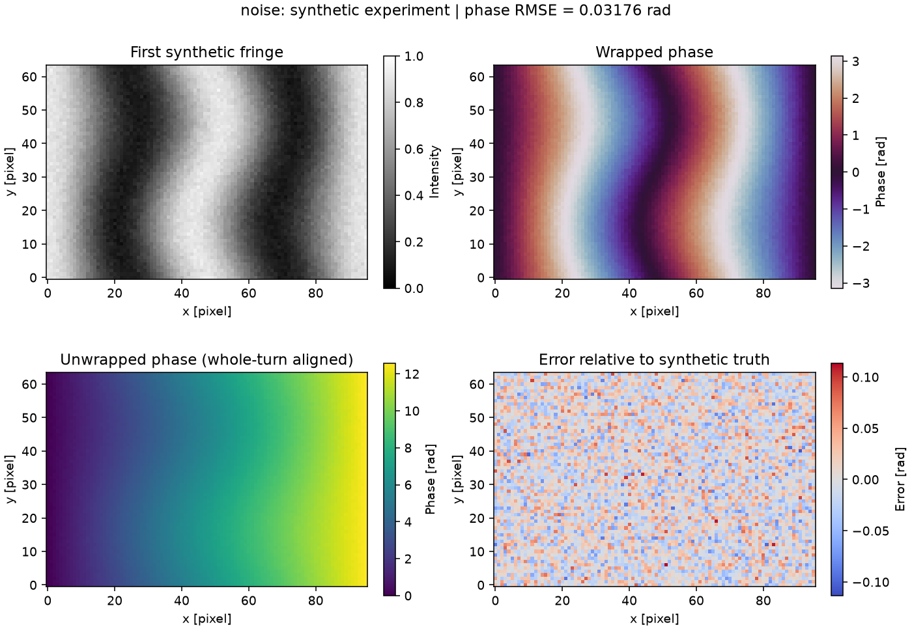

# Phase-Shifting mit synthetischen Streifenbildern

Ein vollständiges kleines Experiment in Python: Streifenbilder erzeugen,
die Phase aus mehreren Bildern berechnen, einfach entpacken und den Fehler
gegen eine bekannte synthetische Referenz auswerten. Alle Bilder und Daten
werden mathematisch erzeugt.



## Ablauf und Modell

1. Eine glatte Referenzphase auf einem Raster von 64 × 96 Pixeln erzeugen.
2. `N` gleichmäßig verschobene Sinusbilder berechnen, standardmäßig `N = 5`.
3. Die gewickelte Phase und die Modulationsamplitude schätzen.
4. Mit `numpy.unwrap` zuerst zeilenweise, dann spaltenweise entpacken.
5. Phasenfehler und Modulation in JSON sowie vier Ansichten pro Fall als PNG speichern.

Für Bild `k = 0, …, N−1` gilt im idealen Fall:

```text
delta_k = 2*pi*k/N
I_k = A + B*cos(phi + delta_k)
C = sum(I_k*cos(delta_k))
S = sum(I_k*sin(delta_k))
wrapped_phase = atan2(-S, C)
modulation = 2*sqrt(C*C + S*S)/N
```

Das Minuszeichen folgt aus der hier gewählten positiven Verschiebung im
Kosinus. `A = 0.5` und `B = 0.4` sind dimensionslose Intensitätsparameter.
Die Phase wird in Radiant angegeben.

Das Experiment führt drei Fälle aus:

| Fall | Änderung der Eingabebilder |
|---|---|
| `clean` | Ideale Bilder |
| `noise` | Gaußsches Intensitätsrauschen mit Standardabweichung `0.02` |
| `drift` | Zusätzlicher Phasenversatz `k * 0.08` rad im Bild `k` |

Der Auswerter nimmt weiterhin die nominalen Schritte an. Der Driftfall zeigt
damit den Fehler durch eine während der Bildfolge veränderte Phase.
Er ist kein räumliches Bewegungsmodell.

## Installation und Ausführung

Voraussetzung: **Python 3.12**. NumPy, Matplotlib und pytest sind in den
Requirements-Dateien auf konkrete Versionen festgelegt.

Windows / PowerShell, im Repository-Hauptverzeichnis:

```powershell
python -m venv .venv
.\.venv\Scripts\python.exe -m pip install -r requirements-dev.txt
.\.venv\Scripts\python.exe -m phase_demo --output out
.\.venv\Scripts\python.exe -m pytest -q
```

Linux, mit Python 3.12 als `python`:

```sh
python -m venv .venv
.venv/bin/python -m pip install -r requirements-dev.txt
.venv/bin/python -m phase_demo --output out
.venv/bin/python -m pytest -q
```

Es entstehen `out/report.json`, `out/clean.png`, `out/noise.png` und
`out/drift.png`. Ein erneuter Lauf überschreibt diese Dateien.
`--steps` setzt die Anzahl der Bilder; `--seed` setzt den nichtnegativen
Zufallsstartwert. Matplotlib speichert die Grafiken ohne Desktop-Fenster.

Mit dem Argument `--steps 2` meldet das Programm einen Fehler und endet mit Exitcode 2.
Ein erfolgreich berechnetes Experiment endet mit 0, auch bei den absichtlich
gestörten Fällen. Der Exitcode ist kein Qualitätsurteil über die Messung.

## Beispielergebnisse und Tests

Der [gespeicherte Beispiellauf](docs/report.json) verwendet fünf Schritte,
Seed 0 und die oben genannten Parameter:

| Fall | RMSE der entpackten Phase [rad] |
|---|---:|
| `clean` | 4.36 × 10⁻¹⁶ |
| `noise` | 0.03176 |
| `drift` | 0.16302 |

Für diesen Vergleich wird ausschließlich ein globales ganzzahliges Vielfaches
von `2*pi` anhand der Referenz korrigiert. Sonstige Phasenfehler bleiben erhalten.
Die Referenz fließt nicht in die Phasenschätzung oder das Entpacken ein.
Die Werte beschreiben diese synthetischen Fälle, keine Genauigkeit realer Geräte.

Lokal unter Windows mit Python 3.12.10: **15 pytest-Fälle bestanden**.
Die Tests prüfen handberechnete Quadranten, drei unterschiedliche Schrittzahlen,
Entpacken über beide Achsen, ungültige Daten, fehlende Modulation und den
CLI-Lauf inklusive JSON und PNG. Der [GitHub-Actions-Workflow](.github/workflows/tests.yml)
führt diese Suite unter Windows und Linux aus. Der lokale Testnachweis oben
bezieht sich auf Windows.

## Dateien und Grenzen

- [`phase_demo/core.py`](phase_demo/core.py): Erzeugung, Phasenschätzung, Entpacken.
- [`phase_demo/experiment.py`](phase_demo/experiment.py): Fälle, Auswertung, Grafiken, CLI.
- [`tests/`](tests/): numerische Prüfungen und vollständiger Programmlauf.

Das einfache Entpacken setzt eine glatte Phase mit Nachbardifferenzen kleiner
als `pi` voraus. Sprünge, Masken, Schatten und starke Störungen können falsche
Ergebnisse erzeugen. Ein Pixel mit geschätzter Modulation unter `1e-6` führt
zum Abbruch; diese Schwelle ersetzt keine Qualitätsanalyse.
Intensitäten bleiben Fließkommazahlen ohne Clipping oder Quantisierung.
Kamerakalibrierung, Stereoauswertung, Höhenrekonstruktion und reale Aufnahmehardware
sind nicht enthalten. Es werden keine Institutsdaten oder Institutsimplementierungen verwendet.

Grundlagen: [N-Schritt-Phasenschätzung, Gleichung 4](https://pmc.ncbi.nlm.nih.gov/articles/PMC9229926/),
[NumPy `unwrap`](https://numpy.org/doc/stable/reference/generated/numpy.unwrap.html).

## English

An independent, synthetic N-step phase-shifting experiment with NumPy.
It generates fringe images, estimates wrapped phase and modulation, unwraps
rows and columns, and compares the result with known truth.
Clean, noisy and drifting-phase cases produce JSON metrics and Matplotlib figures.
Only a global integer-turn ambiguity is removed for evaluation.
This demonstrates phase processing and testing; it does not reconstruct
3D geometry or validate real hardware. The commands above run the experiment
and tests with Python 3.12.

## Lizenz

[MIT](LICENSE), Copyright (c) 2026 Nabwei Elfakhrany.
